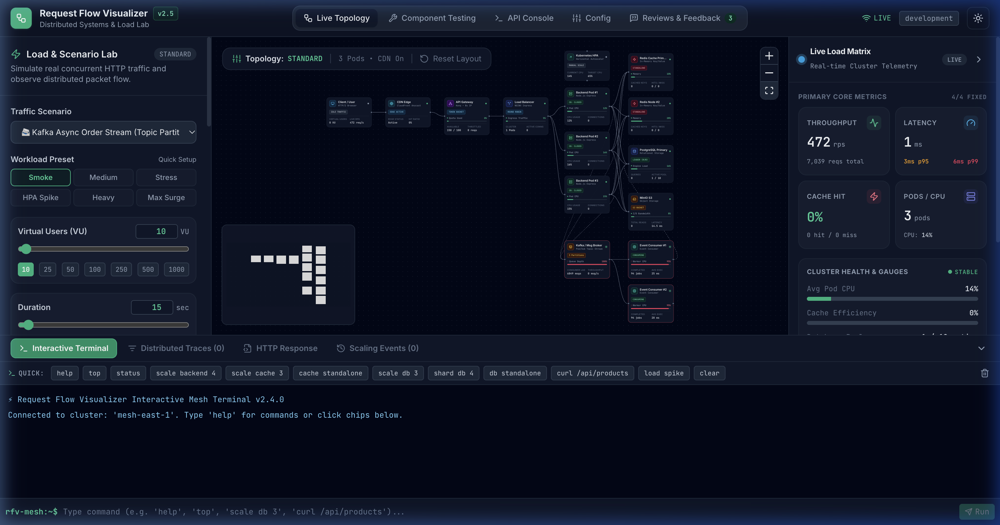
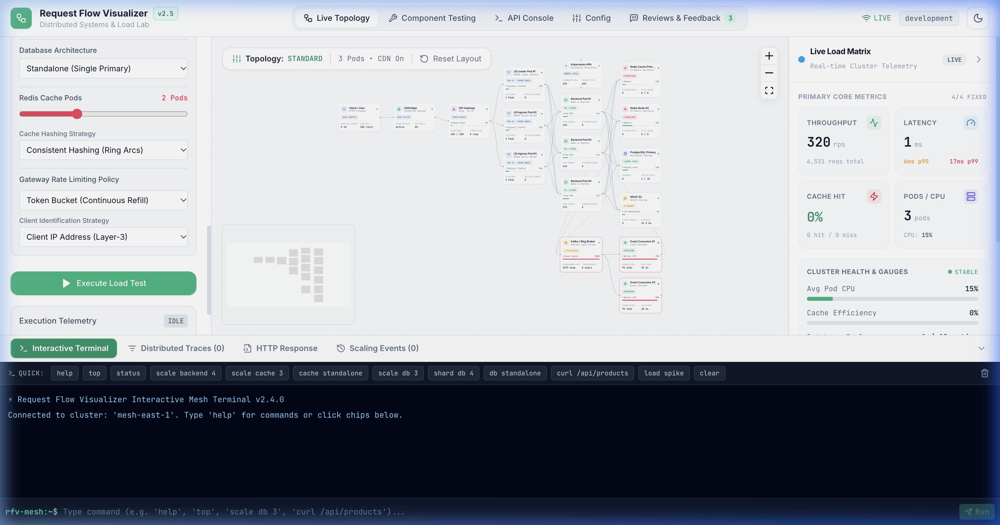
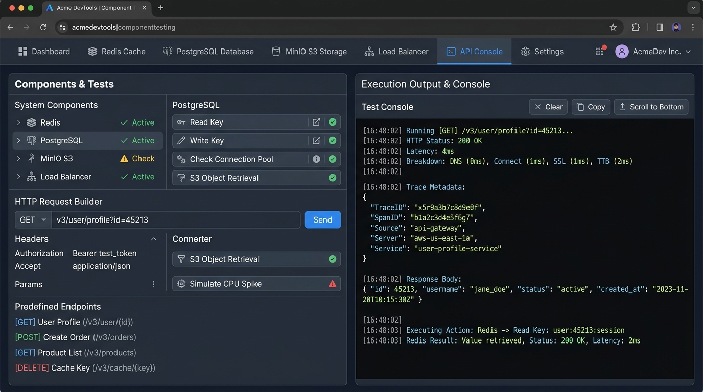

# Distributed Systems Flow Visualizer & Load Testing Lab

[](https://nodejs.org/)
[](https://reactjs.org/)
[](https://www.typescriptlang.org/)
[](https://reactflow.dev/)
[](https://tailwindcss.com/)
[](https://www.docker.com/)
[](https://kubernetes.io/)

A modern, production-grade distributed systems visualization, real-time request tracing, and concurrent load testing developer platform.

---

## 📖 Application Overview

Most system design diagrams are static boxes on a whiteboard. But distributed systems aren't static — they are living topologies governed by backpressure, consumer lag, circuit breakers tripping, partition routing, and cache stampedes.

**Request Flow Visualizer** is an interactive, full-stack distributed systems lab that brings cloud-native architectures to life. It visually demonstrates how a modern system processes incoming HTTP/REST requests, applies API Gateway rate limiting, distributes load across pod replicas, evaluates caching tiers, queries relational databases, stores unstructured S3 objects, streams events through Apache Kafka, and automatically scales stateless compute using the Kubernetes Horizontal Pod Autoscaler (HPA).

### Key Architectural Capabilities:
- **Dynamic Multi-Pod Load Balancing**: Scale L4/L7 load balancers (1 to 4 pods) with Round Robin, Least Connections, and IP Hash algorithms — observe how traffic distribution shifts across backend services in real time.
- **Multi-Node Redis Cluster & Sharding**: Spin up multiple Redis cache nodes on the fly with configurable eviction policies (LRU/LFU) and TTL invalidation.
- **Configurable API Gateway Rate Limiting**: Switch between Token Bucket (with burst allowance), Leaky Bucket, Sliding Window, and Fixed Window algorithms with client identification by IP, API Key, or JWT.
- **Kafka Event Streaming & Distributed Order Sagas**: Watch asynchronous order checkout sagas execute across `Gateway → LB → Backend → Kafka Topic Partitions → Event Consumer Workers → PostgreSQL Database`.
- **Resilience & Chaos Engineering**: Trip circuit breakers to fail-fast, exhaust token buckets, simulate poison-pill messages routing to Dead Letter Queues (DLQ), and monitor HPA autoscaling.
- **Zero-Dependency In-Memory Emulation**: Automatically detects if live Docker services (PostgreSQL, Redis, MinIO) are running; if offline, transparently falls back to local in-memory engines so the app runs 100% out-of-the-box!

---

## 📸 Platform Screenshots

### 1. Live Concurrent Load Testing & Metrics (Dark Mode)
*Real-time distributed request flow under concurrent multi-user load testing, featuring per-pod CPU telemetry, dynamic traffic routing, and p50/p95/p99 latency percentiles.*



### 2. Interactive Multi-Pod Architecture Canvas (Light Mode)
*Interactive React Flow topology canvas showing 3 scaled Load Balancer pods with dynamic traffic distribution, Redis cluster nodes, and live telemetry.*



### 3. Component Testing Lab & API Testing Console
*Dedicated isolation testing suites for Redis Cache, PostgreSQL, MinIO S3, Kafka Message Queues, and Load Balancers alongside an interactive HTTP request console and trace inspection console.*



---

## ⚡ One-Click Quick Start

Get the entire application up and running with a single click or command!

### 🖱️ Double-Click to Launch (Zero Terminal Required)
- **macOS**: Double-click **`mac-launch.command`** in Finder.
- **Linux**: Run or double-click **`linux-launch.sh`**.
- **Windows**: Double-click **`windows-launch.bat`** in File Explorer.

> These launchers automatically verify dependencies, compile builds if needed, start backend & frontend servers, and automatically open **http://localhost:3000** in your default web browser!

---

### 💻 Terminal Quick Start

#### macOS / Linux
```bash
git clone https://github.com/your-username/Request-Flow-Visualizer.git
cd Request-Flow-Visualizer

# Run one-click setup script
chmod +x setup.sh && ./setup.sh

# Start backend & frontend concurrently
npm run dev
```

#### Windows
```cmd
git clone https://github.com/your-username/Request-Flow-Visualizer.git
cd Request-Flow-Visualizer

# Run one-click setup batch script
setup.bat

# Start backend & frontend concurrently
npm run dev
```

#### Alternatively via npm
```bash
npm run setup
npm run dev
```

Open **[http://localhost:3000](http://localhost:3000)** in your browser!

> 💡 **Zero-Dependency In-Memory Mode**: If live Docker services (PostgreSQL, Redis, MinIO) are not running on your machine, the backend transparently falls back to high-fidelity in-memory emulation. It works 100% out-of-the-box!

---

## 🌟 Key Features & Architectural Tiers

### 1. Multi-Pod L4/L7 Load Balancing
- **Dynamic Pod Scaling**: Scale Load Balancer instances on the canvas from **1 to 4 pods** with zero node overlapping.
- **Balancing Strategies**: Supports **Round-Robin**, **Least Connections**, and **IP Hash** algorithms.
- **Active Traffic Distribution**: Ingress Gateway distributes requests across all active LB pods, which in turn dynamically balance across downstream backend pods.

### 2. Multi-Node Redis Distributed Cache Cluster
- **Cluster Sharding**: Dynamically scale Redis from 1 standalone node to **2, 3, or 4 cluster pods**.
- **Cache Eviction & Expiry**: Configurable TTL expiry, LRU/LFU cache policies, and cache hit/miss ratio telemetry.

### 3. Configurable API Gateway Rate Limiting
- **Supported Algorithms**:
  - `token-bucket` (with burst allowance and refill rates)
  - `leaky-bucket` (constant outflow rate)
  - `sliding-window` (timestamp logs with weighted interval counters)
  - `fixed-window` (discrete counter per time slice)
- **Client Identification Strategies**: Rate limits can be tracked per **Client IP (`ip`)**, **API Key (`api-key`)**, or **User JWT (`jwt-user`)**.
- **Visual Badges**: Active rate limiter policies are displayed directly on the Gateway node on the canvas.

### 4. Apache Kafka Messaging & Distributed Sagas
- **E-Commerce Order Saga**: Asynchronously traces distributed transactions end-to-end:
  $$\text{Gateway} \longrightarrow \text{Load Balancer} \longrightarrow \text{Backend} \longrightarrow \text{Kafka Topic Partition} \longrightarrow \text{Worker Consumer} \longrightarrow \text{Database}$$
- **Consistent Partition Key Hashing**: Deterministically routes messages by key (`user-vip-101`, `tenant-eu-west`, etc.) to specific topic partitions to preserve strict ordering.
- **Dead Letter Queue (DLQ)**: Injects malformed poison pills and visualizes worker error handling with automatic routing to the DLQ.
- **Kafka Stream Load Scenario**: Simulates high-throughput asynchronous event publishing directly from the Load Control Panel.

### 5. Concurrent Load Testing & Real-Time Tracing
- **Traffic Generator**: In-engine multi-user HTTP traffic generator with real-time throughput (RPS), p50, p95, and p99 percentiles, status code breakdowns, and configurable concurrency limits.
- **OpenTelemetry Packet Flow**: Dynamic particle animations visually represent real distributed trace paths streamed via WebSockets.

### 6. Independent Component Testing Lab
- Test individual tiers in complete isolation:
  - **Redis Cache**: GET, SET, key invalidation, flush.
  - **PostgreSQL Database**: SELECT, INSERT, connection pool exhaustion.
  - **MinIO S3**: Upload and download simulated media/documents.
  - **Load Balancers**: Traffic dispersion test across algorithms.
  - **Kafka Queue**: Order Saga, partition key hashing, 20-message bursts, poison pill DLQ.
  - **Resilience**: Fail-fast circuit breaker tripping (OPEN/CLOSED/HALF-OPEN) and token exhaustion (HTTP 429).

---

## 🛠️ Technology Stack

| Layer | Technologies |
|---|---|
| **Frontend** | React 18, TypeScript, Tailwind CSS, React Flow (`@xyflow/react`), Lucide React, Vite |
| **Backend** | Node.js, Express.js, TypeScript, WebSockets (`ws`), OpenTelemetry-compatible Tracer |
| **Databases & Storage** | PostgreSQL 16 (`pg`), Redis 7 (`redis`), MinIO S3 (`minio`) |
| **Message Queue** | In-Engine Apache Kafka emulation with Topic Partitions, Consumer Groups & DLQ |
| **Observability** | Prometheus (`prom-client`), Grafana dashboards |
| **Containerization** | Docker, Docker Compose (multi-stage builds) |
| **Orchestration** | Kubernetes manifests with HorizontalPodAutoscaler (HPA) |

---

## 🐳 Docker Compose Deployment

Run the complete multi-container production stack with PostgreSQL, Redis, MinIO, Backend, Frontend, Prometheus, and Grafana:

```bash
docker compose up --build
```

### Access Services:
- **Web Dashboard**: [http://localhost:3000](http://localhost:3000)
- **Backend API**: [http://localhost:4000/api/health](http://localhost:4000/api/health)
- **Prometheus Metrics**: [http://localhost:9090](http://localhost:9090)
- **Grafana Dashboard**: [http://localhost:3001](http://localhost:3001) (Credentials: `admin` / `admin`)
- **MinIO Console**: [http://localhost:9001](http://localhost:9001) (Credentials: `minioadmin` / `minioadmin`)

---

## ☸️ Kubernetes & Autoscaling Deployment

See the comprehensive [Kubernetes Deployment Guide](docs/KUBERNETES_GUIDE.md):

```bash
# Apply Kubernetes manifests in order
kubectl apply -f k8s/00-namespace.yaml
kubectl apply -f k8s/01-configmap-secrets.yaml
kubectl apply -f k8s/02-postgres.yaml
kubectl apply -f k8s/03-redis.yaml
kubectl apply -f k8s/04-minio.yaml
kubectl apply -f k8s/05-backend-deployment.yaml
kubectl apply -f k8s/06-backend-hpa.yaml
kubectl apply -f k8s/07-loadbalancer-gateway.yaml
kubectl apply -f k8s/08-frontend-deployment.yaml

# Watch HPA autoscaling live
kubectl get hpa -n request-flow -w
```

---

## 🌐 Hostinger VPS Deployment

For full VPS setup instructions (firewall, Caddy automated SSL, systemd services, automated database backups), refer to the [Hostinger VPS Production Guide](docs/HOSTINGER_VPS_DEPLOYMENT.md).

```bash
# Launch on VPS using hardened production profile
docker compose -f docker-compose.prod.yml up -d --build
```

---

## 📖 Documentation Directory

- [Architecture & Request Lifecycle](docs/ARCHITECTURE.md)
- [REST API & WebSocket Reference](docs/API_DOCUMENTATION.md)
- [Hostinger VPS Production Deployment](docs/HOSTINGER_VPS_DEPLOYMENT.md)
- [Kubernetes & HPA Autoscaling Guide](docs/KUBERNETES_GUIDE.md)

---

## 📄 License

MIT License. Built for modern cloud-native systems exploration, load testing, and system design interviews.
